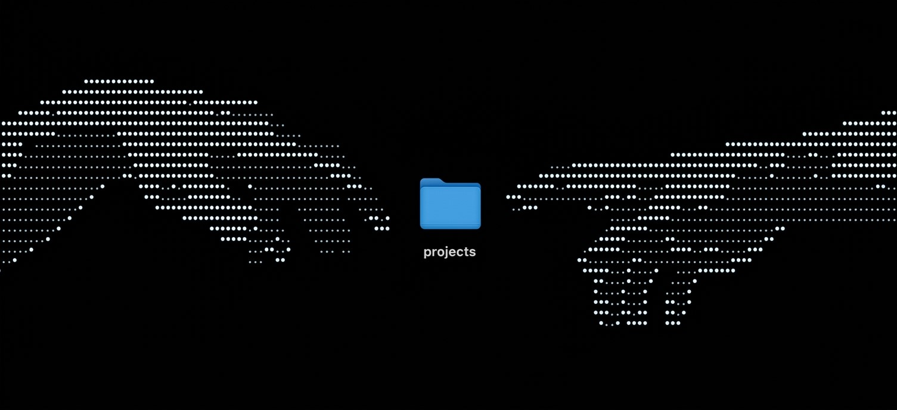
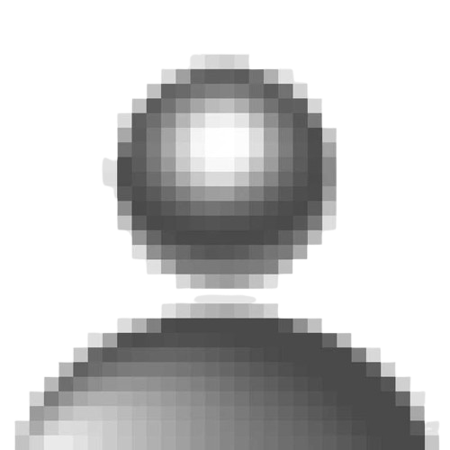
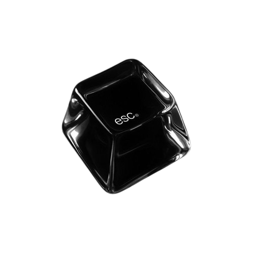

  
  

 

<h2 align="center">
   Sobre mim
</h2>

  Fala! Eu sou o <b>Paulo Vitor</b>, estudante de Ciência da
  Computação na Universidade Católica de Brasília.

  Ainda estou no começo da jornada na programação, aprendendo
  novas tecnologias e colocando em prática o que estudo nos
  meus projetos.

 

<h2 align="center">
   Tecnologias
</h2>

  
  
  
  
  
  

 

<h2 align="center">
   Terminal
</h2>

  

<h2 align="center">Projetos</h2>

  Alguns projetos acadêmicos e pessoais que desenvolvi
  enquanto aprendo programação.

  

 

  <em>Aprendendo no processo.</em>

